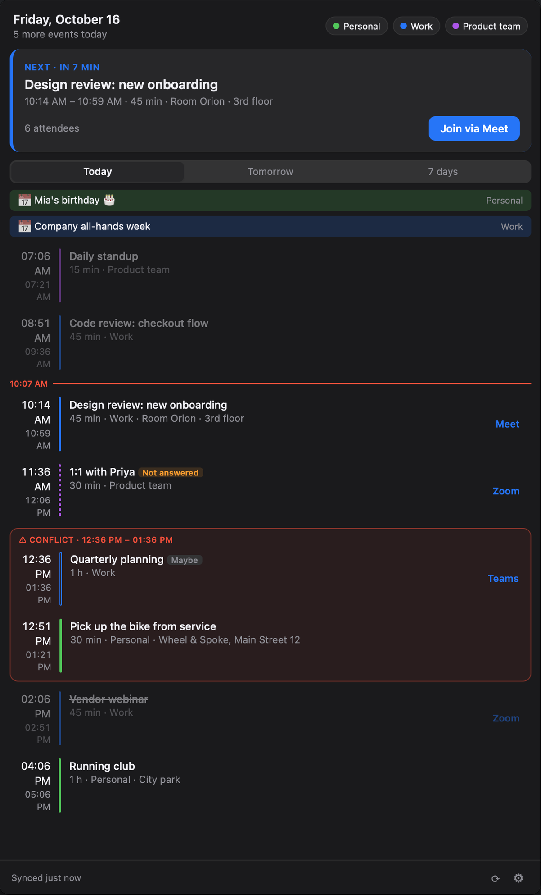
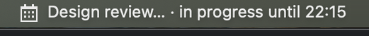
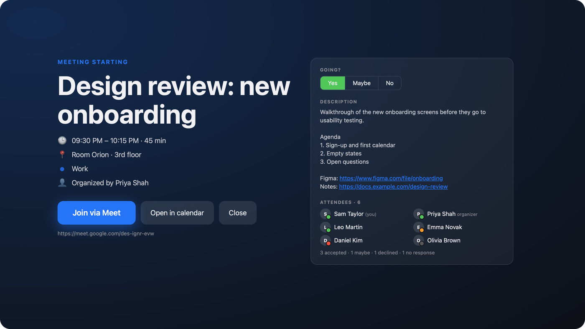

# Do Not Forget

[](https://github.com/mkelcik/do-not-forget/actions/workflows/ci.yml)
[](https://github.com/mkelcik/do-not-forget/releases)
[](LICENSE)

A tray app for Linux, macOS and Windows that keeps your next meeting one glance away,
in the spirit of [MeetingBar](https://github.com/leits/MeetingBar).
Website: <https://donotforget.dev/>





- **Next meeting in the tray**: hover for title, calendar and countdown; click for the agenda.
- **Google Calendar**, several accounts at once: today, tomorrow and the next 7 days merged into one list,
  with overlapping meetings grouped as conflicts. Pick which calendars to show.
- **Join with one click**: Google Meet, Zoom and Teams links are detected; Zoom and Teams open in
  their apps when installed.
- **RSVP** (yes / maybe / no) without opening the calendar.
- **Reminders** before a meeting, and a **maximised alert at the start** for when a notification goes unnoticed.
- **Snooze** the alert or a reminder; **mute** reminders for an hour, the rest of the day, or until you
  turn them back on; or mute or hide one event, a series or a whole calendar.
- **Filters**: only meetings with a link, only accepted ones, only ones with other people; or the
  reminder times set on each event in the calendar.
- **Updates itself** from GitHub Releases, verified by checksum and signature.
- **Translated**: English, Slovak and Czech so far; [add yours](CONTRIBUTING.md#translations).

> Status: early development. Google Calendar works; other providers (Microsoft 365, iCloud,
> CalDAV) are planned.

## Install

On macOS with [Homebrew](https://brew.sh):

```bash
brew install --cask mkelcik/tap/do-not-forget
```

Or download the archive for your system from [Releases](https://github.com/mkelcik/do-not-forget/releases):

| System | File | Notes |
| --- | --- | --- |
| Ubuntu / Kubuntu / Debian x86-64 / ARM64 | `do-not-forget_<version>_<arch>.deb` | Install with `sudo apt install ./do-not-forget_<version>_<arch>.deb`; dependencies are installed automatically. |
| Fedora / openSUSE x86-64 / ARM64 | `do-not-forget_<version>_<arch>.rpm` | Install with `sudo dnf install ./do-not-forget_<version>_<arch>.rpm` (or `sudo zypper install`). |
| Arch Linux | AUR [`do-not-forget-bin`](https://aur.archlinux.org/packages/do-not-forget-bin) | Install with an AUR helper, e.g. `yay -S do-not-forget-bin`. |
| Linux x86-64 / ARM64 | `do-not-forget_linux_*.tar.gz` | Needs GTK 4 and WebKitGTK 6 (`sudo apt install libgtk-4-1 libwebkitgtk-6.0-4`). GNOME needs the AppIndicator extension for tray icons. |
| macOS (Apple Silicon) | `do-not-forget_darwin_arm64.zip` | Not notarized yet: right-click the app → Open on first launch. |
| Windows x86-64 / ARM64 | `do-not-forget_windows_*.zip` | SmartScreen may warn about an unknown publisher. |

Linux releases build on Ubuntu 24.04. The `.deb` and `.rpm` require compatible system
libraries; older distributions may not satisfy their dependencies. The app's update button
installs a newer `.deb` / `.rpm` through `apt-get`, `dnf` or `zypper` after asking for your
password (pkexec); installing it by hand with the same command works too. The AUR package
updates through your AUR helper. Google accounts need a running Secret Service keychain provider.
To build locally, install `dpkg-dev` and `rpm` and run `make dist VERSION=0.1.0` on Linux.

## Google Calendar

Settings → **+ Add account** → Google signs you in in your browser. The app asks to read and
answer your events (`calendar.events`) and to list your calendars
(`calendar.calendarlist.readonly`). Tokens are stored only in the system keychain (macOS
Keychain, Secret Service on Linux, Windows Credential Manager), never in a file;
**Disconnect** revokes the access at Google and deletes them. The app has no servers and no
telemetry; see the [privacy policy](https://donotforget.dev/privacy.html).

### Your own Google client ID

Release builds sign in through the app's own Google OAuth client. You can use your own
instead, e.g. when you build from source, your organisation only allows its own apps, or
you'd rather not go through ours:

1. In [Google Cloud Console](https://console.cloud.google.com/) create a project and enable the
   **Google Calendar API**.
2. **Google Auth Platform → Branding**: fill in the app name and emails.
3. **Audience**: *Internal* if everyone is in your Google Workspace, otherwise *External* and
   add yourself under *Test users* (or publish the app; in *Testing* tokens expire after 7 days).
4. **Data Access → Add or remove scopes**: `.../auth/calendar.events` and
   `.../auth/calendar.calendarlist.readonly`.
5. **Clients → Create client**, type **Desktop app**. Copy the client ID and secret.
6. In the app: Settings → **Own Google client ID**, paste both, Save, then add your account.

Accounts remember the client they signed in with; after switching clients, connect them again.

## Development

Requirements: Go 1.27.3+, Make, and on Linux `libgtk-4-dev libwebkitgtk-6.0-dev`.

```bash
make tools   # golangci-lint, govulncheck (re-run after upgrading Go)
make run     # starts with fake events from dummy.json
make run RUNARGS=   # only your connected accounts
make showcase       # English, every feature on screen (showcase.json), for screenshots
make ci      # everything CI checks
```

For Google in dev builds put a client in `.env` (ignored by Git), or use your own client in Settings:

```
GOOGLE_CLIENT_ID=….apps.googleusercontent.com
GOOGLE_CLIENT_SECRET=GOCSPX-…
```

`dummy.json` is a development event source: times are `"HH:MM"` (with `"day": 1` for tomorrow)
or offsets from app start like `"+12m"`. `-preview-alert` shows the meeting-start alert right away.

Releases: tag a commit on `main` (`git tag v0.1.0 && git push origin v0.1.0`); CI builds
Linux, macOS and Windows archives plus Linux `.deb` and `.rpm` packages, publishes them with
`SHA256SUMS` and updates the Homebrew cask and the AUR package.

Built with Go and [Wails v3](https://v3alpha.wails.io/).

## Contributing

Bug reports, translations and pull requests are welcome: see [CONTRIBUTING.md](CONTRIBUTING.md)
and the [code of conduct](CODE_OF_CONDUCT.md). Security issues: [SECURITY.md](SECURITY.md).
Changes are listed in the [changelog](CHANGELOG.md).

## License

[MIT](LICENSE)
